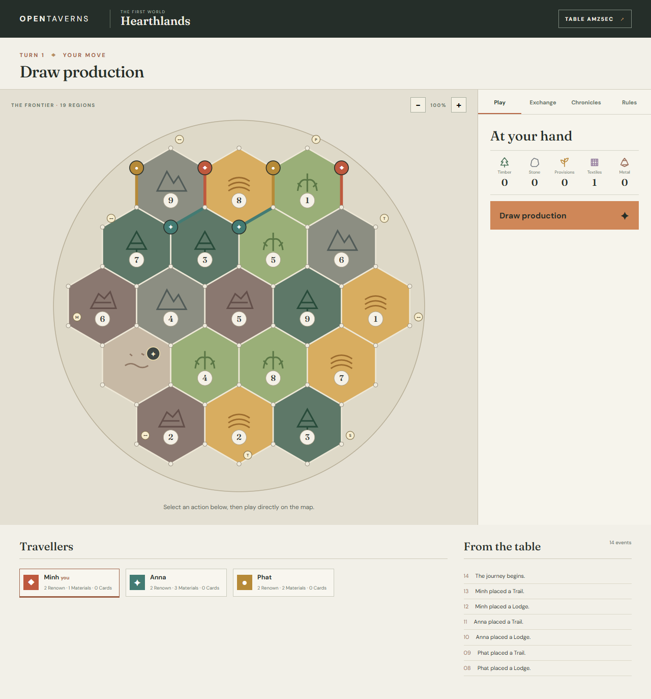
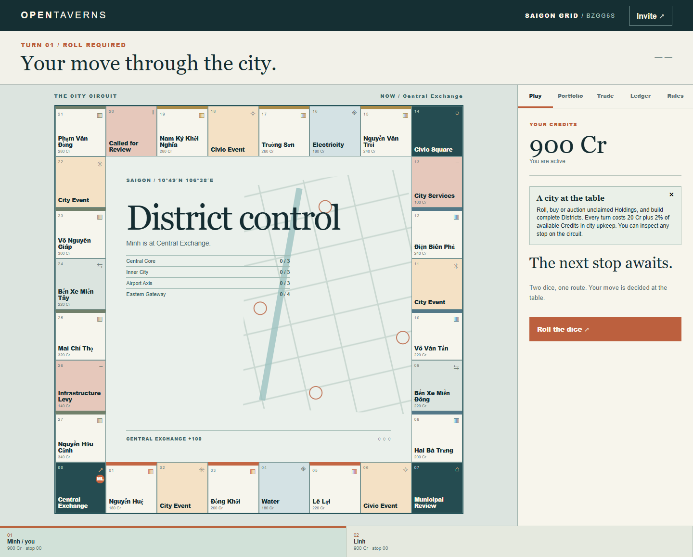
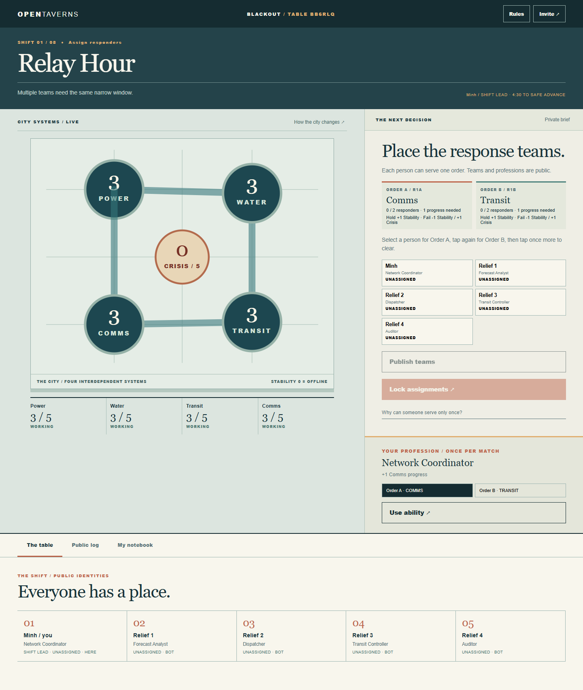
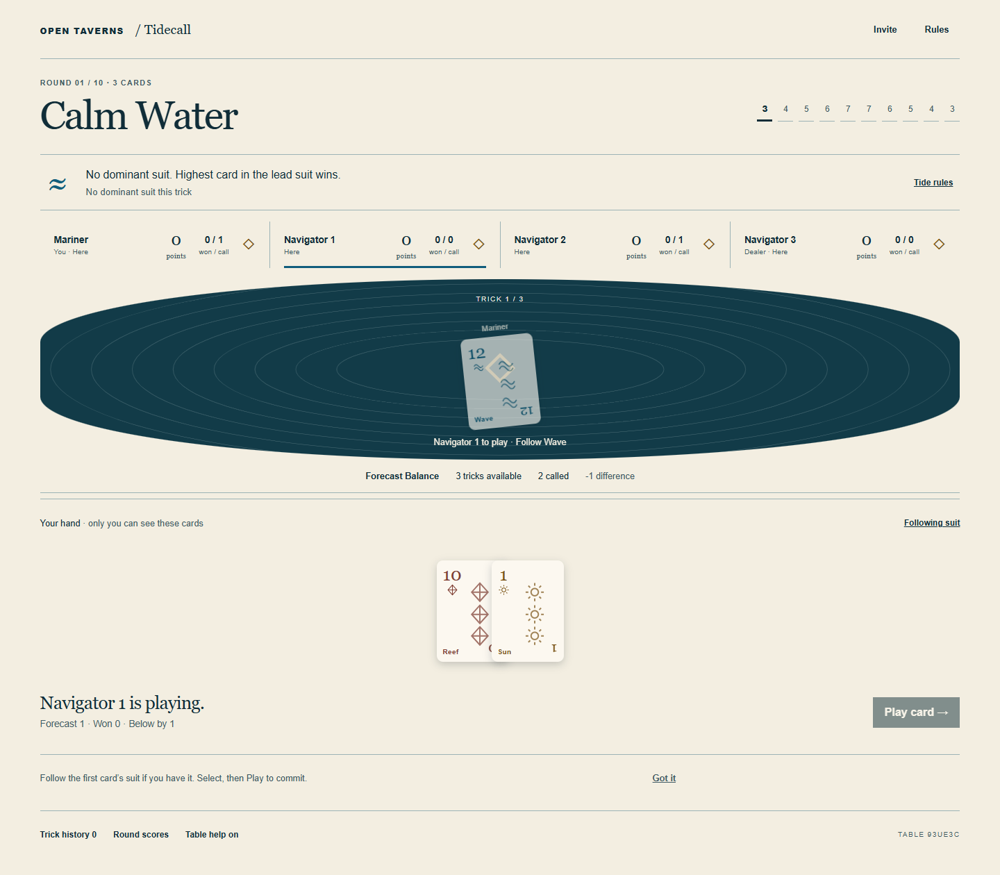
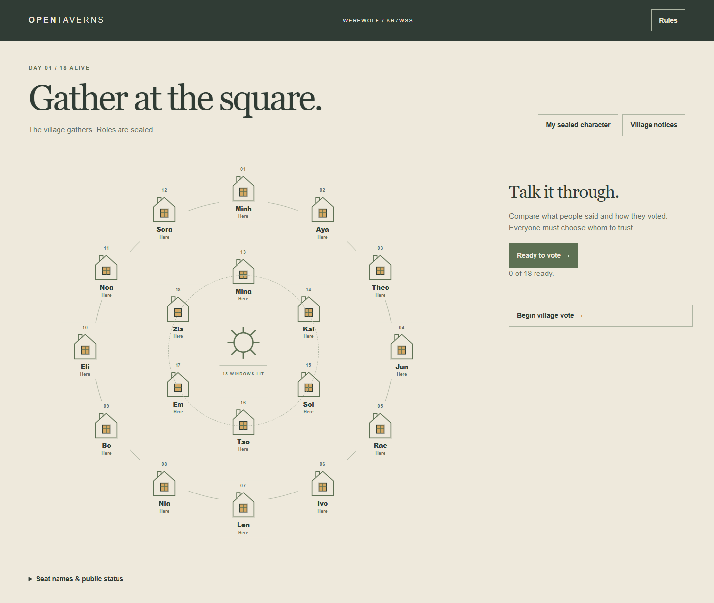
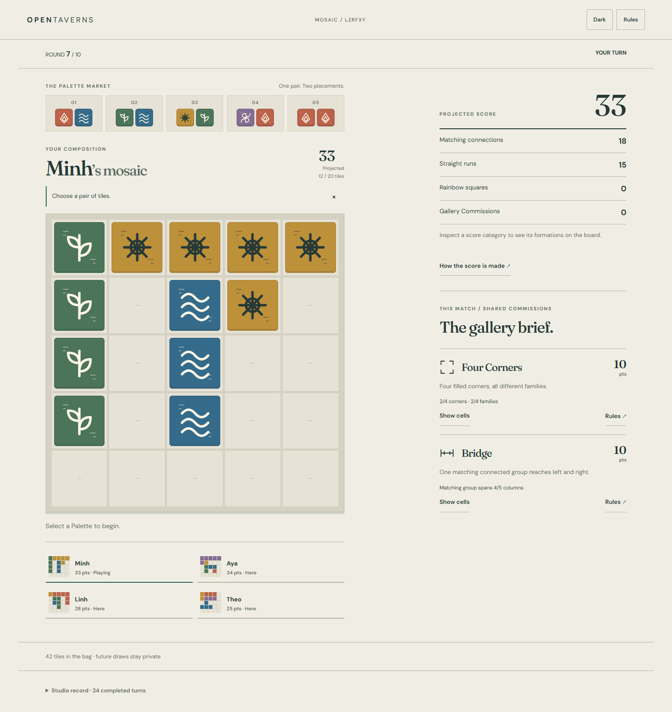

# OpenTaverns

OpenTaverns is a browser-based multiplayer game table for friends. It currently includes six games: **Hearthlands** (3–6 players), an illustrated frontier strategy game; **Saigon Grid** (2–6), a city game about auctions, development, negotiation, and debt; **Blackout** (5–10), hidden-role infrastructure crisis; **Tidecall** (3–6), prediction and trick-taking with private hands; **Werewolf** (8–18), a digital adaptation of *The Werewolves of Miller’s Hollow Classic* with an automatic moderator and optional Defender/Village Idiot roles; and **Mosaic** (2–4), original ceramic tile drafting and composition. Players create or join a table by code, invitation link, or QR code and choose a display name. No account is needed.

The application uses React, TypeScript, Vite, and a Node.js/WebSocket server. Each game has a separate rules engine; the server validates actions and sends each player only the state they are allowed to see. Tables are saved locally so a single server can restore them after restart.



[See the mobile table](docs/images/hearthlands-mobile.png).



[See the Saigon Grid phone board](docs/images/qa/grid-board-mobile-final.png) and [match result](docs/images/qa/qa-grid-result-mobile-pass2.png).



[See Blackout's private phone response](docs/images/qa/blackout-operator-mobile-final.png) and [post-game truth](docs/images/qa/blackout-truth-mobile-final.png).



[See Tidecall's phone Forecast](docs/images/qa/tidecall-forecast-mobile-final.png), [six-player trick](docs/images/qa/tidecall-six-player-mobile-final.png), and [shared Rules](docs/images/qa/tidecall-rules-mobile-final.png).



[See the private phone decision](docs/images/qa/werewolf-witch-mobile-final.png), [engine and edition decisions](docs/werewolf-engine.md), and [role interactions](docs/werewolf-role-interactions.md).



[See Mosaic’s phone preview](docs/images/qa/mosaic-preview-mobile-final.png), [dark studio](docs/images/qa/mosaic-dark-mobile-final.png), and [engine guide](docs/mosaic-engine.md).

## Start locally

Requirements: Node.js 20.19+ or 22.12+ and npm (the installed Vite version's supported Node range).

```sh
npm ci
npm run dev
```

Open `http://localhost:5173`. The web development server forwards API and WebSocket traffic to the authoritative server on port 3000. Choose a game and create a table, then open the invitation in separate browser profiles or devices. The host can add bots in the lobby.

The web development server listens on all network interfaces for local Wi-Fi testing. The API and WebSocket proxy target `localhost:3000`; keep the server on its default port unless you also update the Vite proxy configuration in `apps/web/vite.config.ts`.

For local diagnosis, the development server exposes full table state at `http://localhost:3000/api/debug/tables/CODE`. It is disabled in production and restricted to loopback access.

For a production-style local run:

```sh
npm run build
npm start -w @opentaverns/server
```

Open `http://localhost:3000`. The server serves the built client and WebSockets from one origin.

## Saved tables and host management

All six games save tables automatically to `data/` after every accepted action and room change, before sending the new state. Restart with the same data directory and players can reopen their original links using the same browser cookies. Private hands, roles, locked choices, scores, bots and retry IDs are retained. Human seats begin Away; timed matches pause until the first seated player reconnects, with at least 30 seconds to resume.

The server prints a **private Host management link** at startup. Open it to list all saved tables, reopen invitations and permanently delete tables. The collection footer also links to **Host register** at `/manage`; it requires the key from the private link. A deletion confirmation identifies the table and connected players. Deleting closes connected clients and removes the saved snapshot.

Keep `data/` between upgrades and back it up while the server is stopped. It contains private game state and seat credentials; never publish it. `OPENTAVERNS_DATA_DIR` selects another directory. `OPENTAVERNS_ADMIN_KEY` may supply a private key of 32–200 characters; otherwise a random key is generated once in `data/admin-key`. The key grants management access to every table. A lock prevents two server processes using the same directory.

The server also reads `PORT` (default `3000`; hosting providers commonly set it). The optional variables are `PORT`, `OPENTAVERNS_DATA_DIR`, and `OPENTAVERNS_ADMIN_KEY`. `.env.example` is a reference file; this repository does not load `.env` automatically. Configure variables in your shell or hosting service. Never put real keys in `.env.example` or commit `.env`.

When developing through port 5173, use `/manage` there with the same key, or use the printed port-3000 link after building the client. For deployment, place the data directory on a persistent disk/volume and set `OPENTAVERNS_DATA_DIR` to its mount path. An ephemeral filesystem cannot preserve tables when the host replaces the container.

## Play over local Wi-Fi

Run `npm run dev` on the host computer. Open `http://HOST_IP:5173` from devices on the same Wi-Fi. If the host creates from `localhost`, the invitation replaces that hostname with a private LAN address when one is available. Allow ports 5173 and 3000 through the host firewall if needed. Keep the host computer awake during the match.

## Commands

| Command | Purpose |
| --- | --- |
| `npm run dev` | Web client and game server |
| `npm run build` | Typecheck and build the production client/server |
| `npm run typecheck` | TypeScript checks |
| `npm run lint` | ESLint |
| `npm test` | Rules tests |
| `npm run test:e2e` | Real Edge browser checks; requires Microsoft Edge |
| `npm run simulate -- --games 1000` | Six-player bot simulations |
| `npm run simulate -- --games 100 --players 5 --seed 482913` | Reproduce a simulation range |
| `npm run simulate -- --game saigon-grid --games 1000` | Saigon Grid bot simulations |
| `npm run simulate -- --game blackout --games 1000 --players 10` | Blackout bot simulations, 5–10 seats |
| `npm run simulate -- --game tidecall --games 1000 --players 4` | Tidecall simulations, 3–6 seats; privacy, scoring and Tide metrics |
| `npm run simulate -- --game werewolf --games 1000 --players 12` | Classic Werewolf bot simulation, 8–18 seats; add `--ruleset CLASSIC_PLUS` for Defender/Idiot |
| `npm run simulate -- --game mosaic --games 1000 --players 4` | Mosaic complete-match simulations and pattern/Commission metrics, 2–4 seats |
| `node scripts/tidecall-scoring.mjs` | Compare Tidecall scoring candidates and unconditional zero strategy |

The browser suite is configured for Microsoft Edge (`channel: 'msedge'`) and requires Edge installed on the computer. Development-only scenario tests can be selected with `npm run test:e2e -- --development`; those fixtures are not exposed by production servers.

## Project guides

- [Agent instructions](AGENTS.md) — working conventions and validation commands.
- [Architecture](docs/ARCHITECTURE.md) — runtime boundaries, data flow, privacy and persistence.
- [Current status](docs/CURRENT_STATUS.md) — implemented state, limitations, and next checks.
- [Decision log](docs/DECISIONS.md) — decisions supported by the source, with certainty stated.
- [Network protocol](docs/network-protocol.md), [security model](docs/security.md), and [table storage](docs/table-storage.md).

## How Hearthlands works

The world has 19 hexagonal Regions, 54 Sites, and 72 Links. Each player places a Lodge and connected Trail in seat order, then repeats in reverse order. The second Lodge grants one Material from each adjacent productive Region, subject to shared supply.

On a turn, the active player draws from a ten-mark production wheel. Marks 1–9 produce the matching Regions; Lodges receive one Material and Halls two. A 10 wakes the Rover. Hands above eight discard half, rounded down; the active player moves the Rover and may take one random Material from an eligible neighboring player. The Rover blocks its Region.

The active player may build, exchange with the supply or another player, draw a Chronicle Card, and play one previously drawn Chronicle Card. A five or six-player round ends with **Wayfare**: each player may construct one piece or pass, without another production draw. Trails must connect to a player's network, Lodges must connect to a Trail and cannot neighbor an occupied Site, and Halls upgrade an owned Lodge. Ownership and costs are checked by the server.

| Purchase | Timber | Stone | Provisions | Textiles | Metal |
| --- | ---: | ---: | ---: | ---: | ---: |
| Trail | 1 | 1 | 0 | 0 | 0 |
| Lodge | 1 | 1 | 1 | 1 | 0 |
| Hall | 0 | 0 | 2 | 0 | 2 |
| Chronicle Card | 0 | 0 | 1 | 1 | 1 |

Supply exchanges are 4:1 by default, 3:1 with a generic Exchange, or 2:1 for a matching specialized Exchange. A Lodge is worth one Renown; a Hall is worth two. Great Route and Vanguard each add two. Legacy Chronicle Cards add hidden Renown. Reach **9 Renown** on your own turn to win.

See [the full Hearthlands rules](docs/hearthlands-engine.md) for placement, actions, cards, achievements, and ties.

## How Saigon Grid works

Players travel a 28-stop metropolitan circuit, buy real Ho Chi Minh City street names as Holdings, compete in open auctions, complete Districts, add Developments and Landmarks, trade, and manage Credits and Secured Loans. The two Transit Hubs are **Bến Xe Miền Đông** and **Bến Xe Miền Tây**; the Companies are **Electricity** and **Water**. The last solvent player wins. The rules are original to Saigon Grid, and its Districts are game groupings rather than administrative claims. See the [Saigon Grid rules and verified names](docs/saigon-grid.md) and [engine guide](docs/saigon-grid-engine.md).

## How Blackout works

Every player has a secret faction and an unrelated public profession. Most are Operators; a minority are Disruptors who know one another. Each Incident opens two Work Orders. The rotating Shift Lead assigns separate teams, and assigned players privately lock Stabilize, Diagnose, or, for Disruptors, Interfere. Diagnose sacrifices progress for shared Insight, so a failed order is not proof of sabotage. Two Insight can fund a private simultaneous Audit vote; an Audit reveals the number of Interfere actions on one order, never the actor.

The four systems have public Stability from 0 to 5. Failed orders lower Stability and raise Crisis. Disruptors win at Crisis 5 or when two systems are Offline after resolution. Operators win by surviving eight rounds. Nobody is eliminated early. After the match, a complete round-by-round truth view reveals factions, assignments, actions, abilities, and Audit results. The in-game **Rules** button is available in all six games without leaving the table. See [Blackout's engine and privacy guide](docs/blackout-engine.md).

## How Tidecall works

Ten rounds follow a 3→4→5→6→7→7→6→5→4→3 card arc. Wave, Wind, Reef and Sun each have ranks 1–13. The dealer rotates and the player after them leads first. A public Tide changes dominance or rank order; players always follow the lead suit when able. Forecasts lock privately and reveal together. One Compass per match allows a simultaneous private ±1 correction before the first trick. Exact calls score 12 + 3 per predicted trick; misses lose 4 per trick apart. Highest total wins, then most exact rounds, then shared victory.

Only your own hand and pending choices reach your device. Spectators see played cards and public results. Reconnect restores your seat and locked decisions. The host can replace an Away seat with a bot without changing its hand or score. At the end, Play Again keeps the Table, crew and spectators while resetting the match. Relaxed, Standard and Fast pacing have safe timeout defaults. The same Rules sheet works in the lobby and match. See [Tidecall's engine, privacy and balance guide](docs/tidecall-engine.md) and [visual QA record](docs/tidecall-visual-audit.md).

## How Werewolf works

Classic uses the publisher’s 2023 English rules, with familiar characters and a server moderator. Privately reveal your role, elect a public Sheriff, then alternate padded private nights with public discussion and simultaneous votes. Village must eliminate every wolf; wolves must eliminate every Villager. Parity is not victory. Lovers, Hunter reactions and Sheriff succession resolve completely before victory. The Witch has two independent potions; the Seer learns exact characters. Little Girl peeking has a clearly labelled uncertain digital adaptation.

Classic Plus adds the verified New Moon Defender and Village Idiot. The host may use a recommended pool or build a validated Custom pool. Private prompts, knowledge and locked decisions survive reconnect/restart; bots inherit the same seat and character. After completion, a day-by-day truth reveal exposes all decisions, and Play Again deals fresh roles in the same Table. Rules are available without leaving the current action. See the [engine and source guide](docs/werewolf-engine.md), [interaction matrix](docs/werewolf-role-interactions.md), and [simulation results](docs/werewolf-simulation.json).

## How Mosaic works

Choose one of five persistent two-tile Palettes. Preview both tiles, placing in order beside your existing composition, then confirm one atomic turn. The first tile on an empty board may go anywhere. Every player drafts twenty tiles across ten rounds, with rotating initiative. Matching orthogonal pairs earn 2 points; maximal runs of 3/4/5 add 3/6/10; each filled four-family 2×2 square earns 5. Two shared Gallery Commissions add final bonuses. Ties favor rainbow squares, then completed Commissions, then shared victory.

The phone interface supports tap placement, order changes, editing, Undo, local preview recovery, exact score highlights and opponent inspection. Rules preserve the preview. Light and dark studio treatments keep distinct family marks readable. Server sessions, restart recovery, spectators, bots and Play Again use the same Table. Future bag order stays private. See [exact rules and privacy](docs/mosaic-engine.md), [simulation diagnostics](docs/mosaic-simulation.json) and [visual QA](docs/mosaic-visual-audit.md).

## Architecture

- `packages/hearthlands`: deterministic, headless TypeScript rules, topology, projections, replay, invariants, tests, and bots that act from their own projected view.
- `packages/saigon-grid`: separate deterministic, headless city rules, transactions, events, scenarios, invariants, tests, and bots.
- `packages/blackout`: deterministic simultaneous-action rules, private projections, Incidents, professions, bots, replay, invariants, and development scenarios.
- `packages/tidecall`: deterministic card rules, eight Tides, private hands and simultaneous locks, scoring, replay, bots, invariants and scenarios.
- `packages/werewolf`: Classic and two verified expansion characters, private scheduler, queued death reactions, projections, replay, bots and scenarios.
- `packages/mosaic`: deterministic paired drafting, connected placement, pure patterns/Commissions, supply invariants, public projections, bots, replay and scenarios.
- `apps/server`: shared room and session management, runtime message validation, game dispatch, authoritative actions, WebSocket state delivery, and static hosting.
- `apps/web`: collection, shared table and Rules flows, and separate React renderers for all six games. The client proposes actions; it never decides their validity. Game renderers load on demand.
- `tests/e2e`: multi-browser create/join, a complete six-seat match through victory, refresh and disconnect recovery, host transfer, trade races, security checks, and desktop/mobile screenshots.

The server sends Hearthlands inventory and unrevealed Chronicle Cards only to their owner. Saigon Grid portfolios and its ledger are public; its random state and event decks stay server-side. Blackout sends each player only their own faction, allies if Disruptor, and locked response. Live spectators see public assignments and outcomes without factions or action choices. Blackout's private votes remain hidden until all required votes arrive or the window expires. Its validated action log reconstructs a match. All six rule states serialize as JSON and are stored in atomic room snapshots without changing the rules packages.

See [architecture](docs/ARCHITECTURE.md), [network protocol](docs/network-protocol.md), and [security](docs/security.md).

## Accessibility and mobile

Board Sites, Links, and Rover Regions offer mouse, touch, and keyboard activation, with legal positions highlighted. Materials have labels and distinct silhouettes. Players have colors, sigils, and names. Focus styles and reduced-motion preferences are respected. On phones, the board scrolls within its own surface and the action rail moves below it.

The included web manifest and icon support standalone installation where the browser permits it. Multiplayer requires a live connection; offline play is not provided.

## Deploy

The repository includes `render.yaml` for a single [Render web service](https://render.com/docs/web-services). Connect the repository in Render and deploy the Blueprint, or create one Node web service manually with build command `npm ci && npm run build`, start command `npm start -w @opentaverns/server`, and health path `/health`. Render supports [public WebSocket connections](https://render.com/docs/websocket), so the same HTTPS origin serves the app, API, and `wss` connection. The server binds `0.0.0.0` and reads Render's `PORT` automatically. Choose an always-on single instance and a persistent disk/volume for saved tables. Set OPENTAVERNS_DATA_DIR to its mount path; see the saved-table instructions above.

Do not scale this version to multiple instances: rooms are process-local, and a WebSocket reconnect may reach a different instance. Add shared room persistence and distributed action serialization before doing that. Secure `HttpOnly`, `SameSite=Lax` cookies are issued on HTTPS; the server checks request origins. No CORS configuration is required for the single-origin deployment.

## Current limits and next steps

Tables survive process restarts using their saved data directory. Deployment replacements require a persistent disk/volume. Offline play and sound are not included. Blackout has a post-game truth timeline and replayable engine log, but no interactive live replay viewer. Multi-instance public hosting still requires shared storage and coordinated actions. The six rules packages remain separate from room/session code.
