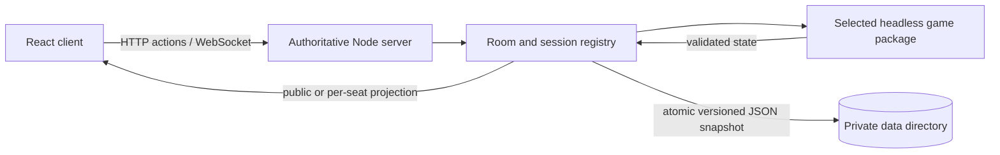

# Architecture

## Repository and runtime

This is an npm-workspaces monorepo. `apps/web` is the React/TypeScript browser application; `apps/server` is the Node.js HTTP and WebSocket host; each `packages/<game>` package owns a deterministic, browser-independent game engine. The web app imports game renderers lazily. Shared table, session and transport code stays in the server and shared web shell.

During development, Vite runs on port 5173 and proxies `/api` and `/ws` to the server on port 3000. In production, the server serves the built `apps/web/dist` client and handles HTTP and WebSocket traffic from one origin. `npm run build` typechecks, builds the client, then bundles the server. The checked-in Render Blueprint runs one Node web service; it needs persistent disk storage for tables. `PORT`, `OPENTAVERNS_DATA_DIR`, and `OPENTAVERNS_ADMIN_KEY` are the server environment settings. See the root README and [table storage](table-storage.md) for setup and operations.

Each room's accepted actions are handled serially by the single server process. The selected engine validates the action and returns a new valid state; the server saves the updated room before acknowledging/broadcasting its viewer-specific projection. This ordering avoids acknowledging unsaved actions. The transport uses HTTP for table/session operations and WebSocket messages for live state and actions; detailed message names are in [network protocol](network-protocol.md).

## Boundaries

The room server knows codes, seats, host privilege, spectators, cookie sessions, connections, and one selected game ID. Hearthlands owns Regions, Materials, private hands, and Renown. Saigon Grid owns its city circuit, Holdings, Credits, auctions, trades, and obligations. Blackout owns factions, professions, Incidents, concurrent Work Orders, Stability, Crisis, Insight, and Audits. Wildways owns its shared landscape, market, influence markers, network control, Milestones and scoring. Each browser renders a projected snapshot and submits a typed action to the selected game's headless `applyAction` engine. Rejected actions leave the original state unchanged.

Room actions are processed sequentially on one Node event loop. This makes trade acceptance atomic for one server instance. Client-supplied IDs select an existing game object or recipient; they never supply random results or authoritative balances.

## Determinism and saves

Hearthlands `createGame(players, seed)` derives terrain, production marks, and Exchanges from a server-owned world seed. A separate 128-bit private key drives an HMAC-SHA-256 counter stream for the Chronicle shuffle, production, and random transfers. In development, an explicit debug seed deterministically derives both streams. Hearthlands `serializeGame`, `restoreGame`, and `replayGame` support snapshots and replay from its validated action history.

Saigon Grid uses a serializable seeded random state for dice and shuffled event decks. Its `gameVersion: 1` state includes all rules data required to resume a match, including auctions, trades, debt, ownership, and supply. The public projection omits the random state and undrawn decks. Connection presence is transport metadata and does not affect either game's rules.

Blackout also has a serializable `gameVersion: 1` state and deterministic incident/role shuffles. Its action log reconstructs a complete match. The explicit phase machine accepts independent responses and votes from several seats without a single active player. Locks and votes remain server-side while pending, and a timeout supplies a safe Stabilize or Save default. Its full history is released in a post-game truth timeline. The room server owns per-phase deadlines, disconnect grace, and bot takeover; Blackout owns the rules for what those events do.

The live room registry is backed by atomic versioned JSON snapshots after accepted actions and room changes, before broadcasts. Saved credentials, game state and retry IDs restore the same table after process restart. Human presence is reset and timed matches pause until a seated player reconnects. A data-directory lock enforces one writer. Keep the server single-instance until shared storage and cross-instance coordination exist. See [table storage and host management](table-storage.md).

## State delivery

Hearthlands `project(game, viewerId)` gives everyone the same board, turn, public totals, achievements, offers, remaining deck count, and events. It adds exact inventory and unrevealed cards only for that viewer. The deck order, private random key/counter, and action log stay on the server. After game over, remaining hidden Legacy cards and final Renown become public. Saigon Grid `project(game)` gives all viewers the same public portfolios and ledger, while withholding random state and undrawn event decks.

Blackout `project(game, viewerId)` sends public systems, professions, teams, lock counts, Incident, and safe history to everyone. A player's own projection adds only their faction, ally IDs if Disruptor, private response, and optional forecast. Spectators receive no `self`. Live projections omit the deck, RNG, action log, and hidden ballots; after `GAME_OVER`, `truth` exposes the complete timeline. The local suspicion notebook never enters the network protocol. The server broadcasts a fresh per-viewer projection after each accepted action or connection change. This is intentionally simple for a small table; measured traffic can justify deltas later.

## Tidecall: private cards and short rounds

Tidecall owns cards, Tides, Forecasts, Compass, trick turns and round scores. Its explicit phases combine simultaneous secret decisions with clockwise card play. Viewer-specific projections send only the viewer's hand and pending locks; spectators receive public tricks and revealed calls. Shared transport never assumes a board or a universal turn model.

Tidecall reuses room pacing, disconnect grace and bot takeover. The server advances short presentation phases and card deadlines; the pure engine decides safe timeout behavior. Every card/Forecast/Compass intention carries round identity, and card play includes trick identity. The transport also checks a match identifier, so an old message cannot apply to a new match with round number one. Independent locks tolerate parallel revision changes; card play requires the current revision.

Host-controlled rematch keeps the existing Table, current host, seats, cookies and spectators. It requires connected human seats or explicit bot replacement and resets only the selected game. Accepted action IDs remain registered and a new match ID prevents cross-match replay. Production uses a fresh seed. The platform still uses small explicit dispatch branches rather than a universal card-game framework.

All seven game modules supply structured content to the same Rules sheet. Game renderers are loaded as separate client chunks and use the existing React/CSS/SVG stack. No new runtime dependency is required.

## Adding a game

Add a game package with serializable state, an authoritative action function, a viewer-specific projection, a client renderer, and a structured `rules` export. Extend the server's game ID dispatch. The shell renders every game's rules in one responsive, accessible sheet without leaving the table. The platform's room/session messages remain about participants and actions, without assuming hexes, property, cards, or one active turn.

## Werewolf: private role schedule and death reactions

Werewolf owns character distribution, Lover relationships, Sheriff office, padded night windows, private pack intentions, simultaneous votes and a deterministic death/reaction queue. It does not use parity victory. Server dispatch routes typed intentions into its pure engine and sends per-seat projections. Night public revisions stay unchanged while secret choices arrive; the server maintains fixed window deadlines even without an eligible character. Dead seats lose live private prompts except their own mandatory reaction. Final truth and replay become public only after completion.

Werewolf uses the existing sessions, latest-tab policy, idempotent action IDs, grace, takeover, durable saves, Rules sheet and rematch transport. Its prompt window and match identifier reject stale actions while permitting independent simultaneous arrivals. Its lazy frontend chunk supplies an original SVG village and private phone controls. No generic social-game framework was introduced. See [Werewolf engine](werewolf-engine.md).

## Mosaic: atomic drafting and composition

Mosaic owns its conserved hundred-tile pool, five two-tile market slots, connected personal boards, rotating initiative and pure scoring/Commission predicates. The engine validates two ordered placements before consuming an offer or changing a board. Scores are derived from boards. DRAFTING and GAME_OVER are authoritative; preview/order/undo are client-local and keyed to match/turn. The public projection omits future bag order and random state.

The platform reuses cookie sessions, UUID retries, current-tab control, deadlines/grace, populated-seat takeover, atomic saves, shared Rules and fresh-match lifecycle. A shared small player-count table replaces repeated bound expressions. A lazy game chunk supplies DOM/SVG ceramics and responsive score inspection. See [Mosaic engine](mosaic-engine.md).

## Wildways: a shared landscape and changing control

Wildways owns a seeded supply of 72 tiles, a three-offer public market and a shared orthogonal map. Each player places one tile per turn. Same-habitat neighbors form a region; Trail or Stream tiles connect only when matching ports face across an edge. A placed tile can receive one of its owner's eight permanent Survey Markers, for its habitat or route, or the marker can be saved. Merged components combine influence, so control and projected network scores are recalculated from the map after each move.

Habitat regions of three or more tiles score 2 per tile and 3 per landmark. Route networks of three or more score 3 per tile and 2 per landmark. Unique control awards the full value; a tie splits it evenly and rounds each award down. One seeded Habitat Milestone and one Network Milestone are selected per match. Only the active player is checked after their turn; a qualifying first claim earns permanent 8 or 10 point value. Match lengths are configured per player count: 18 turns each at two seats, 15 at three, 13 at four and 12 at five. Standings compare total score, Milestones claimed, and uniquely controlled scoring networks; any remaining tie is shared.

The `PLACING` and `GAME_OVER` phases are authoritative. The browser stages tile, rotation, coordinate and optional marker choices locally and can preview resulting control, scores and Milestone claims through the pure `previewTurn` function. It commits one `PLACE_LANDSCAPE_TILE` action containing round, turn, revision, offer and tile IDs, coordinate, orientation and marker mode. The server validates the strict action schema, match ID, revision and engine legality before saving. On deadline, the server calls the engine's system-only `TIMEOUT`; its deterministic fallback uses the first market offer, first legal coordinate, zero rotation and no marker.

All players and spectators receive the same public projection: board, remaining offer data, markers, influence, control, score, Milestones and history. The tile bag order, random state and action log remain server-side. The interface uses the `.wy` root, `.wy-dark` theme and `--w-*` tokens for its nature-atlas palette and controls. Its lazy renderer provides a panning/zooming map, rotation and legal-placement controls, network inspection, local scoring preview, responsive score rails, light/dark theme and English/German/Vietnamese text. See [Wildways engine and rules](wildways-engine.md).

## Verified scope and limitations

The components above are implemented in the repository. Named scenario routes are development-only; they are not production game content. Persistence is a local single-writer JSON store, not a distributed database. Rooms and live sockets are process-local, so the current server must run as one instance. Client-side preview state (for example, Mosaic or Wildways placement staging) is distinct from accepted server state. E2E tests use Playwright configured for the installed Microsoft Edge browser channel.
